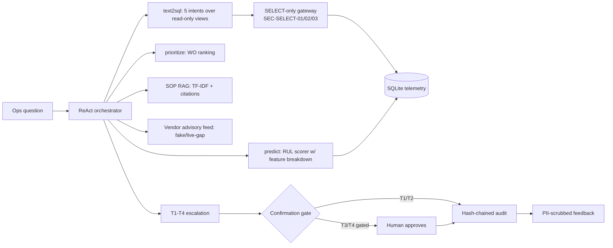

# Architecture



```mermaid
flowchart TD
    S[sensor readings] --> F1[vibration slope]
    S --> F2[temperature slope]
    S --> F3[vibration level]
    A[asset age] --> F4[age factor]
    F1 --> R[risk score 0-1]
    F2 --> R
    F3 --> R
    F4 --> R
    R --> RUL[RUL days = 180 x (1 - risk)]
    R --> PRIO[WO score = criticality x P(fail) x impact]
```
